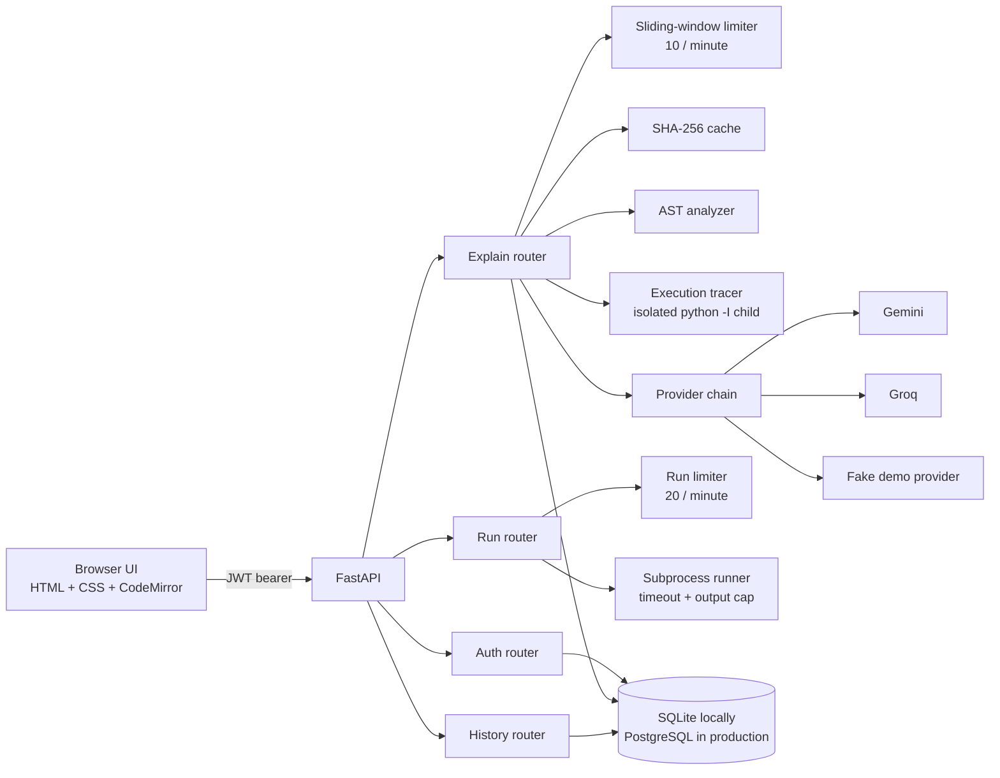
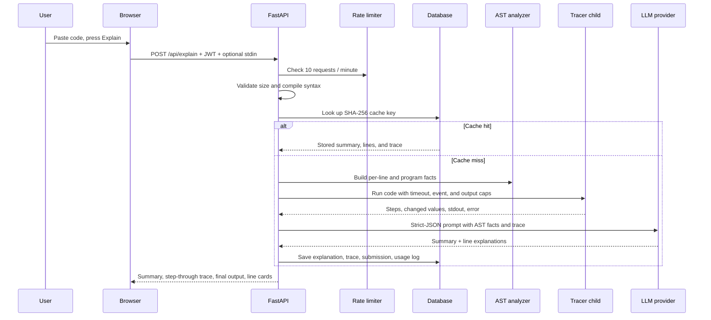
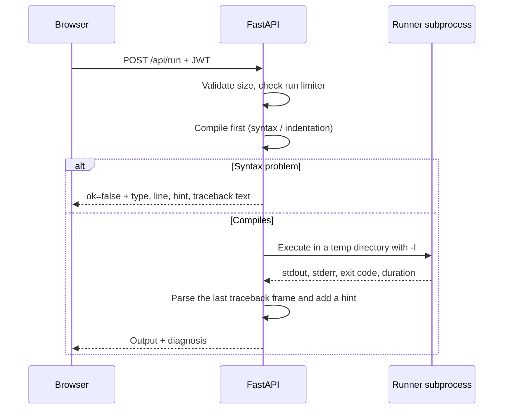

# LineLens

LineLens explains Python one line at a time, grounded in the code's abstract syntax tree (AST) and in a real execution trace. Paste a snippet, press **Explain**, and get a plain-English summary, a step-through walkthrough with the actual values from each line, and a card for every non-blank line. Press **Run** to execute the snippet and see its output, including a learner-friendly diagnosis of syntax, indentation, and runtime errors.

The interface is deliberately warm and quiet: an always-black editor, an off-white light theme, a charcoal dark theme, and a single orange accent. No gradients, glassmorphism, or neon.

## Features

- **Line-by-line explanations** from Gemini, Groq, or a deterministic demo provider.
- **Step-through execution tracing** — the code runs in a separate process, and the UI shows the real value of each changed variable, the output produced at each step, a memory panel, and how many times each line ran.
- **AST-grounded prompts** so the model sees functions, classes, imports, loop nesting, complexity hints, and per-line node facts, plus the execution trace.
- **Run and diagnose** Python in a subprocess with a timeout, output caps, and friendly hints for common mistakes.
- **Mistakes in the explanation** — a run-time error is sent with the explain request, so the summary and the failing line mention it. Syntax and indentation errors appear as a "What went wrong" card in the explanation panel.
- **Optional program input** for `input()` calls, with a 1,000-character limit. The same input is used by Explain and Run.
- **Content-addressed caching** with SHA-256, so repeated snippets are free and fast. Stdin and run-time error context are part of the cache key; programs that import `random`, `time`, or `datetime` are never cached because their trace can change.
- **Two request budgets** — 10 explanations per minute and 20 runs per minute, plus 50 real AI calls per user per day. Cache hits do not consume the daily AI budget.
- **Provider fallback** from the primary to the backup on rate-limit or server errors.
- **JWT auth**, bcrypt password hashing, per-user history, and ownership-isolated history detail.
- **Light/dark themes** saved in `localStorage`, responsive layout, keyboard shortcuts, and accessible dialogs.
- **95 passing backend tests** (plus one POSIX-only memory-limit test skipped on Windows) covering auth, AST analysis, tracing and its safety limits, child-process secrets, caching, providers, limits, history, execution, and error diagnosis.

## Architecture



### Explain request flow



### Run request flow



## Tech stack

| Layer | Choice |
| --- | --- |
| API | Python 3.12, FastAPI, Uvicorn |
| Validation | Pydantic v2 |
| Data | SQLAlchemy 2, SQLite locally, PostgreSQL via `DATABASE_URL` |
| Auth | PyJWT (HS256), bcrypt |
| Analysis | Python standard-library `ast` |
| AI | `google-genai` (Gemini), `groq` (Groq), deterministic fake provider |
| Frontend | Vanilla HTML/CSS/JS, CodeMirror 5 from a CDN |
| Tests | pytest, httpx/TestClient, pytest-mock |

## Quick start

### Windows (PowerShell)

```powershell
py -3.12 -m venv .venv
.\.venv\Scripts\Activate.ps1
pip install -r requirements.txt
Copy-Item .env.example .env
# Optional: add GEMINI_API_KEY or GROQ_API_KEY to .env.
# With no keys, LineLens uses the deterministic demo provider.
.\.venv\Scripts\python.exe -m uvicorn app.main:app --reload
```

### macOS / Linux

```bash
python3.12 -m venv .venv
source .venv/bin/activate
pip install -r requirements.txt
cp .env.example .env
# Optional: add GEMINI_API_KEY or GROQ_API_KEY to .env.
uvicorn app.main:app --reload
```

Open:

- App: <http://127.0.0.1:8000>
- API docs: <http://127.0.0.1:8000/docs>
- Health: <http://127.0.0.1:8000/health>

The database schema is created automatically on startup. With no `DATABASE_URL`, the app uses `./linelens.db` (SQLite). With no API key, it uses the **Demo** provider, which is deterministic and clearly labelled in the UI.

## Environment variables

| Variable | Default | Purpose |
| --- | --- | --- |
| `ENV` | `development` | Set to `production` to refuse startup while `JWT_SECRET` is still the development placeholder. |
| `DATABASE_URL` | `sqlite:///./linelens.db` | SQLAlchemy database URL. Use `postgresql+psycopg://...` for PostgreSQL. |
| `JWT_SECRET` | development placeholder | Signing secret. Set a long random value outside local development. |
| `JWT_EXPIRE_MINUTES` | `1440` | Access-token lifetime (24 hours). |
| `LLM_PROVIDER` | `gemini` | `gemini`, `groq`, or `fake`. |
| `GEMINI_API_KEY` | empty | Google AI Studio key. |
| `GEMINI_MODEL` | `gemini-2.5-flash` | Gemini model name. |
| `GROQ_API_KEY` | empty | Groq Console key. |
| `GROQ_MODEL` | `llama-3.3-70b-versatile` | Groq model name. |
| `RATE_LIMIT_REQUESTS` | `10` | Explain requests allowed per window. |
| `RATE_LIMIT_WINDOW_SECONDS` | `60` | Explain rate-limit window. |
| `DAILY_AI_LIMIT` | `50` | Real (non-cached) AI calls per user per UTC day. |
| `MAX_CODE_CHARS` | `5000` | Maximum characters accepted by Explain and Run. |
| `MAX_CODE_LINES` | `300` | Maximum lines accepted by Explain and Run. |
| `RUN_RATE_LIMIT_REQUESTS` | `20` | Code executions allowed per window. |
| `RUN_RATE_LIMIT_WINDOW_SECONDS` | `60` | Run rate-limit window. |
| `RUN_TIMEOUT_SECONDS` | `5` | Wall-clock execution timeout for the Run button. |
| `TRACE_TIMEOUT_SECONDS` | `3` | Wall-clock limit for the tracing child process. |
| `TRACE_MAX_EVENTS` | `500` | Maximum execution steps recorded per trace. |
| `TRACE_MAX_OUTPUT_CHARS` | `10000` | Maximum stdout captured from the tracing child. |
| `TRACE_MEMORY_LIMIT_MB` | `256` | Address-space limit for the tracing child (POSIX only). |

## API

All endpoints except register, login, and health require `Authorization: Bearer <token>`. Errors share one envelope:

```json
{
  "error": {
    "code": "rate_limited",
    "message": "Too many requests. Try again in 42 seconds.",
    "retry_after": 42
  }
}
```

### `POST /api/auth/register`

```json
{
  "email": "ada@example.com",
  "password": "correct-horse-battery"
}
```

`201 Created`:

```json
{
  "access_token": "eyJhbGciOiJIUzI1NiIs...",
  "token_type": "bearer",
  "user": {
    "id": 1,
    "email": "ada@example.com",
    "created_at": "2026-10-24T08:00:00Z"
  }
}
```

### `POST /api/auth/login`

Same body as register. Returns the same token response.

### `GET /api/auth/me`

Returns the current user. Useful for restoring a session from a stored token.

### `POST /api/explain`

```json
{
  "code": "def greet(name):\n    return f\"Hello {name}\"\n\nprint(greet(\"Ada\"))\n"
}
```

Optional error context, normally taken from the last run:

```json
{
  "code": "print(1 / 0)\n",
  "error_context": {
    "type": "ZeroDivisionError",
    "message": "division by zero",
    "line": 1,
    "hint": "Something is being divided by zero. Guard the denominator before dividing.",
    "phase": "runtime"
  }
}
```

Optional program input for `input()`, used by the tracer (maximum 1,000 characters):

```json
{
  "code": "name = input()\nprint(f\"Hi {name}\")\n",
  "stdin": "Ada\n"
}
```

`200 OK` (analysis and steps abbreviated):

```json
{
  "id": 12,
  "code": "def greet(name):\n    return f\"Hello {name}\"\n\nprint(greet(\"Ada\"))\n",
  "summary": "This 4-line Python program defines one function and prints its result.",
  "lines": [
    {
      "line": 1,
      "code": "def greet(name):",
      "explanation": "Defines the function `greet` with one parameter, `name`.",
      "run_count": 1,
      "runs": [1]
    },
    {
      "line": 2,
      "code": "    return f\"Hello {name}\"",
      "explanation": "Builds a greeting with an f-string and returns it.",
      "run_count": 1,
      "runs": [3]
    },
    {
      "line": 4,
      "code": "print(greet(\"Ada\"))",
      "explanation": "Calls `greet` with `Ada` and prints the returned string.",
      "run_count": 1,
      "runs": [2]
    }
  ],
  "analysis": {
    "total_lines": 4,
    "functions": [{ "name": "greet", "line": 1, "args": ["name"], "async": false }],
    "classes": [],
    "imports": [],
    "max_loop_nesting": 0,
    "complexity_hint": "no loops, likely O(1) for straight-line code"
  },
  "trace_status": "ok",
  "trace_note": null,
  "final_output": "Hello Ada\n",
  "trace_error": null,
  "steps": [
    {
      "step": 1,
      "line": 1,
      "function": "<module>",
      "depth": 0,
      "event": "line",
      "variables": { "greet": "<function greet>" },
      "stdout": "",
      "failing": false
    }
  ],
  "provider": "gemini",
  "cached": false,
  "created_at": "2026-10-24T08:05:00Z"
}
```

`steps` is abbreviated above; a call to a user function also records `line` and `return` events inside that function. `run_count` is the real number of times the line ran, while `runs` lists at most the first five step numbers so the payload stays small.

A syntax error returns `422` with `line`, `column`, `syntax_message`, `error_type`, `hint`, and `phase`, so the UI can explain the mistake without calling a model.

When tracing cannot run — a blocked import, a timeout, a syntax error, or a tracer crash — the request still succeeds. `trace_status` is `"unavailable"`, `trace_note` explains why, `steps` is empty, and `final_output` is empty. The summary and line explanations then come from the AST alone.

### `POST /api/run`

```json
{
  "code": "print(sum([1, 2, 3]))\n"
}
```

`200 OK`:

```json
{
  "ok": true,
  "stdout": "6\n",
  "stderr": "",
  "exit_code": 0,
  "duration_ms": 84,
  "timed_out": false,
  "error": null
}
```

A failing program is still a `200` response with `ok: false` and a diagnosis:

```json
{
  "ok": false,
  "stdout": "",
  "stderr": "Traceback (most recent call last):\n  File \"<your code>\", line 2, in <module>\n    print(items[5])\n          ~~~~~^^^\nIndexError: list index out of range\n",
  "exit_code": 1,
  "duration_ms": 91,
  "timed_out": false,
  "error": {
    "type": "IndexError",
    "message": "list index out of range",
    "line": 2,
    "column": null,
    "hint": "The index is outside the list or string. Check its length and your loop bounds.",
    "phase": "runtime"
  }
}
```

Syntax and indentation errors return immediately with `ok: false`, `exit_code: null`, `duration_ms: 0`, and a formatted `<your code>` traceback. A timeout returns `timed_out: true` and a `TimeoutError` diagnosis.

### `GET /api/history?limit=50`

```json
{
  "items": [
    {
      "id": 12,
      "summary": "This 4-line Python program defines one function and prints its result.",
      "line_count": 3,
      "provider": "gemini",
      "created_at": "2026-10-24T08:05:00Z"
    }
  ]
}
```

### `GET /api/history/{submission_id}`

Returns the same shape as `POST /api/explain` with `cached: false`. A submission owned by another user returns `404`, indistinguishable from a missing id.

### `GET /health`

```json
{ "status": "ok" }
```

## Execution tracing

Explanations are grounded in what the program actually did, not only in what the syntax tree says it should do. Every changed value, every piece of output, and every run count shown in the UI comes from running the snippet.

### How it works

1. `POST /api/explain` validates the snippet, then starts a separate child process with `python -I -B -X utf8` in a fresh temporary directory with a minimal environment.
2. The child compiles the source with the filename `<user_code>` and installs `sys.settrace` before executing it. Only frames from `<user_code>` are recorded, so library internals stay out of the trace.
3. Each recorded step has a step number, line, function name, call depth, event (`line` or `return`), the variables that changed since the previous step in that frame, the stdout produced during the step, and whether it is the line that failed. Exception events are used to stop cleanly and mark the failing line, not stored as separate steps.
4. A changed value is attributed to the line that just finished, because that is when the assignment became visible. Values are `repr()` strings, shortened to 80 characters, with at most three items per collection and two levels of nesting. Dunder names, modules, and built-in functions are skipped.
5. If an exception escapes, the trace stops at the failing line, that step is marked `failing`, and `trace_error` carries the type, message, and line.
6. The prompt receives the code, the AST facts, and a compact trace. The model returns strict JSON with only a `summary` and one `explanation` per line, and is told to use only the values present in the trace and never to invent one.
7. The backend merges the model's prose with the trace. Values, steps, run counts, final output, and the failing line always come from execution, not from the model.

For this snippet:

```python
a, b = 1, 2
c = a + b
print(c)
```

the trace is:

| Step | Line | Changed values | New output |
| --- | --- | --- | --- |
| 1 | `a, b = 1, 2` | `a = 1`, `b = 2` | |
| 2 | `c = a + b` | `c = 3` | |
| 3 | `print(c)` | | `3` |

`final_output` is `"3\n"`. The UI opens on step 1 and moves with **Next**, **Back**, or the left and right arrow keys. **Show all** switches to the full list of line cards. The current line is highlighted softly in orange, changed values appear as chips, the memory panel shows the names recorded so far, and a line that ran more than once gets a run table with up to five rows plus “and N more runs”.

The same facts are exposed by the API. `trace_status` is `"ok"` or `"unavailable"`, `trace_note` explains a fallback or a truncation, `final_output` is the complete captured stdout, and each entry in `lines` carries `run_count` (the real number of runs) and `runs` (up to five step numbers). `steps` holds the full ordered walkthrough, including changed values and per-step output.

### Safety limits

| Limit | Default | What happens |
| --- | --- | --- |
| Wall clock | 3 seconds | The child is killed and the explanation falls back to AST-only with a clear note. |
| Steps | 500 | Tracing stops and the note says `Tracing stopped after 500 steps.` |
| Output | 10,000 characters | Output capture stops and the note says it was capped. |
| Memory | 256 MB | `RLIMIT_AS` is applied on POSIX. On Windows the limit is skipped rather than faked. |
| Imports | allowlist | `math`, `random`, `time`, `datetime`, `json`, `re`, `collections`, `itertools`, `functools`, `string`, `typing`, `dataclasses`, `statistics`, `decimal`, `fractions`, `heapq`, `bisect`, `operator`, and `copy` are allowed. Anything else raises a clear “not allowed in LineLens” error. |
| Built-ins | allowlist | `open`, `exec`, `eval`, `compile`, `breakpoint`, and direct `__import__` access are removed from the user namespace. |
| Environment | minimal | The child does not inherit API keys or `JWT_SECRET`. On Windows it keeps only `SYSTEMROOT` so Python can start. |
| Program input | 1,000 characters | `input()` reads the optional `stdin` field. At end of input it raises `EOFError`, exactly like normal Python, instead of hanging. |

A blocked import, a timeout, a syntax error, or a tracer crash never blanks the page. The request still returns `200`, with `trace_status: "unavailable"`, a `trace_note` explaining what happened, and line explanations built from the AST.

### Honest limitations

- **This is not a sandbox.** The child runs as the server user. The import allowlist and removed built-ins are defense-in-depth for a local teaching demo, not a security boundary; Python introspection can still reach parts of the runtime. A public deployment should trace inside a container or a dedicated sandbox with CPU, memory, filesystem, and network limits.
- **Only user-code frames are traced.** Calls into the standard library or an allowed module do not produce steps, so a single line may hide a lot of internal work.
- **Values are snapshots, not live objects.** You see a short `repr()` after a line finishes. You cannot inspect object identity, mutation inside one line, generators mid-iteration, or very large structures in full.
- **Event limits can beat the clock.** A tight infinite loop such as `while True: pass` usually reaches the 500-step cap before the 3-second timeout, so it returns a truncated but successful trace rather than a timeout. The note says tracing stopped.
- **Nondeterministic programs are not cached.** Snippets importing `random`, `time`, or `datetime` are re-traced on every request, because the same source can produce a different trace.

## Tests

```powershell
.\.venv\Scripts\python.exe -m pytest -q
```

```bash
pytest -q
```

The suite uses a temporary SQLite database and an isolated fake provider, so it needs no network and no API keys. It covers:

- JWT registration, login, duplicate email, invalid tokens, and `/api/auth/me`.
- AST facts for functions, classes, imports, loops, depth, and complexity.
- Tracer step order, changed values, function call depth, stdout, run counts, and failing-line marking.
- Tracer safety: blocked imports, syntax errors, timeouts, step and output caps, stdin, and the POSIX memory limit.
- Child processes receive a minimal environment, so `/api/run` output and tracer notes cannot expose API keys or `JWT_SECRET`; `open()` and non-allowlisted imports are blocked in the tracer.
- Production configuration refuses to start with the default `JWT_SECRET` placeholder.
- Trace-aware explain responses, caching with and without a trace, stdin in the cache key, and nondeterministic imports bypassing the cache.
- Rebuilding cache rows written before tracing existed.
- History detail returning the stored steps, run counts, and final output.
- An end-to-end three-line trace with `a = 1`, `b = 2`, `c = 3`, and output `3`.
- Cache hits, normalization, provider retries, fallback, and unavailable providers.
- Per-minute limits, `Retry-After`, daily caps, and cache hits not consuming AI budget.
- History listing, detail, and cross-user ownership isolation.
- Code execution: stdout, exit codes, syntax/indentation/runtime diagnosis, timeouts, output clipping, and the separate run limiter.
- Error context forwarded to the provider and cached separately.

## Design decisions

**AST-first grounding.** The analyzer produces deterministic facts before any model call. The prompt includes those facts and asks the model to explain every non-blank line exactly once. This reduces invented behavior and keeps line numbers aligned with the source.

**Strict JSON, one retry.** Providers must return a validated JSON object. A malformed response is retried once with the same provider; it does not silently switch providers, because that would hide a response-contract problem. Availability failures (rate limit, server error, transport error) do fall back to the backup provider.

**Content-addressed caching.** The cache key is SHA-256 of normalized code (line endings unified, trailing whitespace removed) plus any program input. Run-time error context is appended to the key, so "explain this code" and "explain this code and its ZeroDivisionError" are different cache entries. Snippets importing `random`, `time`, or `datetime` are never cached because their trace can change between runs; the response still gets a storage hash so history works. Cache rows written before tracing existed are deleted and rebuilt the next time they are requested, rather than showing a structure-only explanation forever. Cache hits create a submission and usage log but never consume the daily AI budget.

**Values come from execution.** The model is good at prose and bad at arithmetic. So the trace, not the model, owns every concrete value: changed variables, step order, run counts, stdout, final output, and the failing line. The prompt includes those values and explicitly forbids inventing one. The backend then merges the model's per-line explanations with the trace fields, which means a wrong claim in the summary cannot corrupt the value chips.

**Trace-first with an honest fallback.** Tracing is a separate `python -I` child with an import allowlist, safe built-ins, a fresh temporary directory, an empty environment, and time, step, output, and memory caps. When tracing is unavailable, the explanation still succeeds from AST facts and says why. The fallback is deliberate: a blocked import or a slow program should not turn into a blank page.

**Two independent budgets.** Explanations and runs have separate sliding-window limiters. Explaining is an AI call; running is CPU time. Sharing one bucket would make a run consume an explanation allowance, which is confusing. The daily cap is counted from non-cached `usage_logs`, so it survives process restarts.

**Subprocess execution, not a sandbox.** The runner writes the snippet to a temporary directory and starts `python -I -B -X utf8` with a wall-clock timeout and clipped output. The tracer uses the same pattern with `sys.settrace` and an import allowlist. This is appropriate for a local teaching demo. It is **not** a security boundary: the child still runs as the server user and can use the network. A public deployment should run snippets in a container or a dedicated sandbox with CPU, memory, filesystem, and network limits. This limitation is called out rather than hidden.

**A minimal child environment.** Run and trace children do not inherit the server environment, so learner code cannot read `GEMINI_API_KEY`, `GROQ_API_KEY`, or `JWT_SECRET`. On Windows the child keeps `SYSTEMROOT` because the Python runtime needs it to start; everywhere else the environment is empty. The test suite sets sentinel secrets and probes `os.environ` through both paths to keep this from regressing.

**Production refuses the default secret.** `ENV=production` combined with the development `JWT_SECRET` placeholder raises a validation error during startup. Local development still starts with a warning, so cloning the repository stays frictionless while a deployment cannot accidentally sign tokens with a public placeholder.

**Diagnosis in plain English.** Compile errors are converted into a line number, a short message, and a specific hint (missing colon, extra indentation, mixed tabs and spaces, and so on). Runtime tracebacks are parsed for the last user-code frame and mapped to hints for common exceptions. The UI shows this as a "What went wrong" card and highlights the line in the editor.

**SQLite by default.** `DATABASE_URL` is optional, so a reviewer can clone the repository and run it without Docker or a database server. PostgreSQL works through the same SQLAlchemy models by setting one variable. There is no Alembic migration layer because the project creates a fresh schema on startup; a small idempotent SQLite migration adds the trace columns to an existing local database. That is a deliberate portfolio-scale simplification.

**No frontend framework.** The UI is plain HTML, CSS, and JavaScript. CodeMirror is the only runtime dependency and is loaded from a CDN. State is small and explicit, dialogs use the native `<dialog>` element, and theme preference is stored in `localStorage`. The editor stays black in both themes for consistent syntax colors.

**Accessibility.** The layout has a skip link, labelled controls, visible focus rings, native dialogs, live regions for status and errors, keyboard shortcuts, and a plain-textarea fallback if CodeMirror fails to load.

## Project structure

```text
linelens/
├── app/
│   ├── config.py              # Environment-backed settings
│   ├── database.py            # Engine, session factory, schema init
│   ├── deps.py                # Bearer-token user dependency
│   ├── errors.py              # APIError and unauthorized helper
│   ├── main.py                # App factory, error handlers, static files
│   ├── models.py              # User, Submission, Explanation, UsageLog
│   ├── schemas.py             # Pydantic request/response models
│   ├── security.py            # bcrypt and JWT helpers
│   ├── llm/
│   │   ├── base.py            # Prompt, strict JSON validation, retry
│   │   ├── fake.py            # Deterministic demo provider
│   │   ├── gemini.py          # Google Gemini adapter
│   │   └── groq.py            # Groq adapter
│   ├── routers/
│   │   ├── auth.py            # Register, login, me
│   │   ├── explain.py         # Validation, cache, AI, persistence
│   │   ├── history.py         # List and detail with ownership checks
│   │   └── run.py             # Subprocess execution endpoint
│   ├── services/
│   │   ├── analyzer.py        # Pure AST facts
│   │   ├── cache.py           # Normalization and SHA-256 keys
│   │   ├── child_env.py       # Minimal environment for execution children
│   │   ├── explainer.py       # Provider chain and fallback
│   │   ├── rate_limiter.py    # Thread-safe sliding window
│   │   ├── runner.py          # Compile, execute, diagnose
│   │   └── tracer.py          # Isolated trace child, steps, values, caps
│   └── static/
│       ├── index.html
│       ├── style.css
│       └── app.js
├── postman/
│   └── linelens.postman_collection.json
├── tests/
├── .env.example
├── requirements.txt
└── README.md
```

## Possible improvements

- **Production rate limiting.** The current limiter is in-process. Multiple Uvicorn workers or replicas need a shared store such as Redis so the budget is global.
- **A real execution sandbox.** Move Run and the tracer into a container or a service such as gVisor/Firecracker with no network, a read-only filesystem, memory and CPU limits, and a hard kill. The import allowlist is not a substitute for this.
- **Richer tracing.** Follow calls into allowed modules, capture return values at the call site, and show object identity or mutation inside a single line instead of only a `repr()` snapshot.
- **Migrations.** Add Alembic before changing the schema in a deployed environment.
- **Streaming.** Stream the summary and line cards as the model produces them instead of waiting for the full JSON object.
- **Token accounting.** Track prompt/completion tokens per provider to make the daily budget cost-aware, not just call-count-aware.
- **Account lifecycle.** Add refresh tokens, email verification, password reset, and per-user deletion.
- **Editor persistence.** Save the last snippet and result per user, or in `localStorage`, so a refresh does not lose work.
- **More languages.** The AST layer is Python-specific by design; a tree-sitter adapter could extend the same interface.
- **Observability.** Structured request logs, provider latency metrics, cache hit rate, and error budgets.
- **CI.** Run pytest plus a Playwright smoke test on every pull request.

## License

This is a portfolio project. Add a license file before distributing it.
