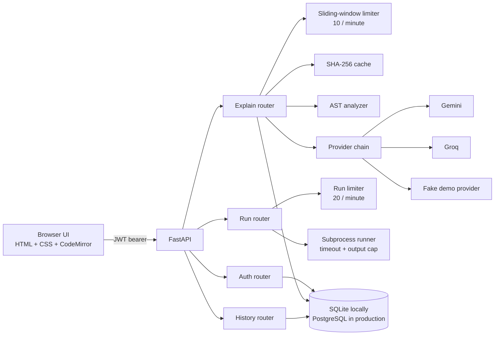
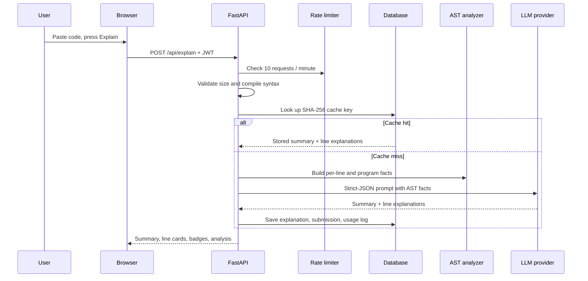
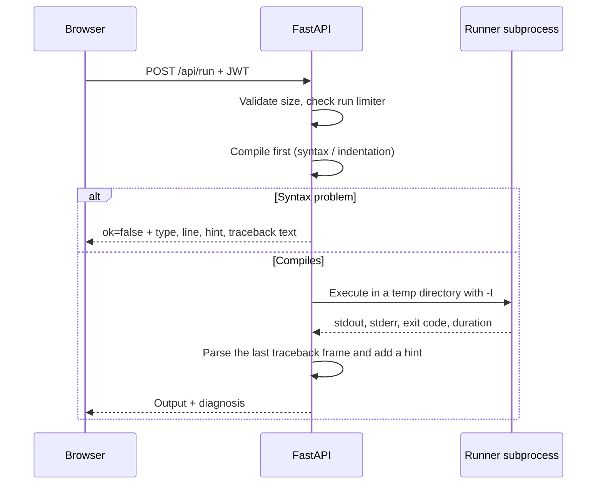

# LineLens

LineLens explains Python one line at a time, grounded in the code's abstract syntax tree (AST). Paste a snippet, press **Explain**, and get a plain-English summary plus a card for every non-blank line. Press **Run** to execute the snippet and see its output, including a learner-friendly diagnosis of syntax, indentation, and runtime errors.

The interface is deliberately warm and quiet: an always-black editor, an off-white light theme, a charcoal dark theme, and a single orange accent. No gradients, glassmorphism, or neon.

## Features

- **Line-by-line explanations** from Gemini, Groq, or a deterministic demo provider.
- **AST-grounded prompts** so the model sees functions, classes, imports, loop nesting, complexity hints, and per-line node facts.
- **Run and diagnose** Python in a subprocess with a timeout, output caps, and friendly hints for common mistakes.
- **Mistakes in the explanation** — a run-time error is sent with the explain request, so the summary and the failing line mention it. Syntax and indentation errors appear as a "What went wrong" card in the explanation panel.
- **Content-addressed caching** with SHA-256, so repeated snippets are free and fast. A run-time error context is part of the cache key.
- **Two request budgets** — 10 explanations per minute and 20 runs per minute, plus 50 real AI calls per user per day. Cache hits do not consume the daily AI budget.
- **Provider fallback** from the primary to the backup on rate-limit or server errors.
- **JWT auth**, bcrypt password hashing, per-user history, and ownership-isolated history detail.
- **Light/dark themes** saved in `localStorage`, responsive layout, keyboard shortcuts, and accessible dialogs.
- **57 backend tests** covering auth, AST analysis, caching, providers, limits, history, execution, and error diagnosis.

## Architecture



### Explain request flow



### Run request flow



## Tech stack

| Layer | Choice |
| --- | --- |
| API | Python 3.12, FastAPI, Uvicorn |
| Validation | Pydantic v2 |
| Data | SQLAlchemy 2, SQLite locally, PostgreSQL via `DATABASE_URL` |
| Auth | PyJWT (HS256), bcrypt |
| Analysis | Python standard-library `ast` |
| AI | `google-genai` (Gemini), `groq` (Groq), deterministic fake provider |
| Frontend | Vanilla HTML/CSS/JS, CodeMirror 5 from a CDN |
| Tests | pytest, httpx/TestClient, pytest-mock |

## Quick start

### Windows (PowerShell)

```powershell
py -3.12 -m venv .venv
.\.venv\Scripts\Activate.ps1
pip install -r requirements.txt
Copy-Item .env.example .env
# Optional: add GEMINI_API_KEY or GROQ_API_KEY to .env.
# With no keys, LineLens uses the deterministic demo provider.
.\.venv\Scripts\python.exe -m uvicorn app.main:app --reload
```

### macOS / Linux

```bash
python3.12 -m venv .venv
source .venv/bin/activate
pip install -r requirements.txt
cp .env.example .env
# Optional: add GEMINI_API_KEY or GROQ_API_KEY to .env.
uvicorn app.main:app --reload
```

Open:

- App: <http://127.0.0.1:8000>
- API docs: <http://127.0.0.1:8000/docs>
- Health: <http://127.0.0.1:8000/health>

The database schema is created automatically on startup. With no `DATABASE_URL`, the app uses `./linelens.db` (SQLite). With no API key, it uses the **Demo** provider, which is deterministic and clearly labelled in the UI.

## Environment variables

| Variable | Default | Purpose |
| --- | --- | --- |
| `DATABASE_URL` | `sqlite:///./linelens.db` | SQLAlchemy database URL. Use `postgresql+psycopg://...` for PostgreSQL. |
| `JWT_SECRET` | development placeholder | Signing secret. Set a long random value outside local development. |
| `JWT_EXPIRE_MINUTES` | `1440` | Access-token lifetime (24 hours). |
| `LLM_PROVIDER` | `gemini` | `gemini`, `groq`, or `fake`. |
| `GEMINI_API_KEY` | empty | Google AI Studio key. |
| `GEMINI_MODEL` | `gemini-2.5-flash` | Gemini model name. |
| `GROQ_API_KEY` | empty | Groq Console key. |
| `GROQ_MODEL` | `llama-3.3-70b-versatile` | Groq model name. |
| `RATE_LIMIT_REQUESTS` | `10` | Explain requests allowed per window. |
| `RATE_LIMIT_WINDOW_SECONDS` | `60` | Explain rate-limit window. |
| `DAILY_AI_LIMIT` | `50` | Real (non-cached) AI calls per user per UTC day. |
| `MAX_CODE_CHARS` | `5000` | Maximum characters accepted by Explain and Run. |
| `MAX_CODE_LINES` | `300` | Maximum lines accepted by Explain and Run. |
| `RUN_RATE_LIMIT_REQUESTS` | `20` | Code executions allowed per window. |
| `RUN_RATE_LIMIT_WINDOW_SECONDS` | `60` | Run rate-limit window. |
| `RUN_TIMEOUT_SECONDS` | `5` | Wall-clock execution timeout. |

## API

All endpoints except register, login, and health require `Authorization: Bearer <token>`. Errors share one envelope:

```json
{
  "error": {
    "code": "rate_limited",
    "message": "Too many requests. Try again in 42 seconds.",
    "retry_after": 42
  }
}
```

### `POST /api/auth/register`

```json
{
  "email": "ada@example.com",
  "password": "correct-horse-battery"
}
```

`201 Created`:

```json
{
  "access_token": "eyJhbGciOiJIUzI1NiIs...",
  "token_type": "bearer",
  "user": {
    "id": 1,
    "email": "ada@example.com",
    "created_at": "2026-10-24T08:00:00Z"
  }
}
```

### `POST /api/auth/login`

Same body as register. Returns the same token response.

### `GET /api/auth/me`

Returns the current user. Useful for restoring a session from a stored token.

### `POST /api/explain`

```json
{
  "code": "def greet(name):\n    return f\"Hello {name}\"\n\nprint(greet(\"Ada\"))\n"
}
```

Optional error context, normally taken from the last run:

```json
{
  "code": "print(1 / 0)\n",
  "error_context": {
    "type": "ZeroDivisionError",
    "message": "division by zero",
    "line": 1,
    "hint": "Something is being divided by zero. Guard the denominator before dividing.",
    "phase": "runtime"
  }
}
```

`200 OK` (analysis abbreviated):

```json
{
  "id": 12,
  "code": "def greet(name):\n    return f\"Hello {name}\"\n\nprint(greet(\"Ada\"))\n",
  "summary": "This 4-line Python program defines one function and prints its result.",
  "lines": [
    {
      "line": 1,
      "code": "def greet(name):",
      "explanation": "Defines the function `greet` with one parameter, `name`."
    },
    {
      "line": 2,
      "code": "    return f\"Hello {name}\"",
      "explanation": "Builds a greeting with an f-string and returns it."
    },
    {
      "line": 4,
      "code": "print(greet(\"Ada\"))",
      "explanation": "Calls `greet` with `Ada` and prints the returned string."
    }
  ],
  "analysis": {
    "total_lines": 4,
    "functions": [{ "name": "greet", "line": 1, "args": ["name"], "async": false }],
    "classes": [],
    "imports": [],
    "max_loop_nesting": 0,
    "complexity_hint": "no loops, likely O(1) for straight-line code"
  },
  "provider": "gemini",
  "cached": false,
  "created_at": "2026-10-24T08:05:00Z"
}
```

A syntax error returns `422` with `line`, `column`, `syntax_message`, `error_type`, `hint`, and `phase`, so the UI can explain the mistake without calling a model.

### `POST /api/run`

```json
{
  "code": "print(sum([1, 2, 3]))\n"
}
```

`200 OK`:

```json
{
  "ok": true,
  "stdout": "6\n",
  "stderr": "",
  "exit_code": 0,
  "duration_ms": 84,
  "timed_out": false,
  "error": null
}
```

A failing program is still a `200` response with `ok: false` and a diagnosis:

```json
{
  "ok": false,
  "stdout": "",
  "stderr": "Traceback (most recent call last):\n  File \"<your code>\", line 2, in <module>\n    print(items[5])\n          ~~~~~^^^\nIndexError: list index out of range\n",
  "exit_code": 1,
  "duration_ms": 91,
  "timed_out": false,
  "error": {
    "type": "IndexError",
    "message": "list index out of range",
    "line": 2,
    "column": null,
    "hint": "The index is outside the list or string. Check its length and your loop bounds.",
    "phase": "runtime"
  }
}
```

Syntax and indentation errors return immediately with `ok: false`, `exit_code: null`, `duration_ms: 0`, and a formatted `<your code>` traceback. A timeout returns `timed_out: true` and a `TimeoutError` diagnosis.

### `GET /api/history?limit=50`

```json
{
  "items": [
    {
      "id": 12,
      "summary": "This 4-line Python program defines one function and prints its result.",
      "line_count": 3,
      "provider": "gemini",
      "created_at": "2026-10-24T08:05:00Z"
    }
  ]
}
```

### `GET /api/history/{submission_id}`

Returns the same shape as `POST /api/explain` with `cached: false`. A submission owned by another user returns `404`, indistinguishable from a missing id.

### `GET /health`

```json
{ "status": "ok" }
```

## Tests

```powershell
.\.venv\Scripts\python.exe -m pytest -q
```

```bash
pytest -q
```

The suite uses a temporary SQLite database and an isolated fake provider, so it needs no network and no API keys. It covers:

- JWT registration, login, duplicate email, invalid tokens, and `/api/auth/me`.
- AST facts for functions, classes, imports, loops, depth, and complexity.
- Cache hits, normalization, provider retries, fallback, and unavailable providers.
- Per-minute limits, `Retry-After`, daily caps, and cache hits not consuming AI budget.
- History listing, detail, and cross-user ownership isolation.
- Code execution: stdout, exit codes, syntax/indentation/runtime diagnosis, timeouts, output clipping, and the separate run limiter.
- Error context forwarded to the provider and cached separately.

## Design decisions

**AST-first grounding.** The analyzer produces deterministic facts before any model call. The prompt includes those facts and asks the model to explain every non-blank line exactly once. This reduces invented behavior and keeps line numbers aligned with the source.

**Strict JSON, one retry.** Providers must return a validated JSON object. A malformed response is retried once with the same provider; it does not silently switch providers, because that would hide a response-contract problem. Availability failures (rate limit, server error, transport error) do fall back to the backup provider.

**Content-addressed caching.** The cache key is SHA-256 of normalized code (line endings unified, trailing whitespace removed). Run-time error context is appended to the key, so "explain this code" and "explain this code and its ZeroDivisionError" are different cache entries. Cache hits create a submission and usage log but never consume the daily AI budget.

**Two independent budgets.** Explanations and runs have separate sliding-window limiters. Explaining is an AI call; running is CPU time. Sharing one bucket would make a run consume an explanation allowance, which is confusing. The daily cap is counted from non-cached `usage_logs`, so it survives process restarts.

**Subprocess execution, not a sandbox.** The runner writes the snippet to a temporary directory and starts `python -I -B -X utf8` with a wall-clock timeout and clipped output. This is appropriate for a local teaching demo. It is **not** a security boundary: the child still runs as the server user and can use the network. A public deployment should run snippets in a container or a dedicated sandbox with CPU, memory, filesystem, and network limits. This limitation is called out rather than hidden.

**Diagnosis in plain English.** Compile errors are converted into a line number, a short message, and a specific hint (missing colon, extra indentation, mixed tabs and spaces, and so on). Runtime tracebacks are parsed for the last user-code frame and mapped to hints for common exceptions. The UI shows this as a "What went wrong" card and highlights the line in the editor.

**SQLite by default.** `DATABASE_URL` is optional, so a reviewer can clone the repository and run it without Docker or a database server. PostgreSQL works through the same SQLAlchemy models by setting one variable. There is no Alembic migration layer because the project creates a fresh schema on startup; that is a deliberate portfolio-scale simplification.

**No frontend framework.** The UI is plain HTML, CSS, and JavaScript. CodeMirror is the only runtime dependency and is loaded from a CDN. State is small and explicit, dialogs use the native `<dialog>` element, and theme preference is stored in `localStorage`. The editor stays black in both themes for consistent syntax colors.

**Accessibility.** The layout has a skip link, labelled controls, visible focus rings, native dialogs, live regions for status and errors, keyboard shortcuts, and a plain-textarea fallback if CodeMirror fails to load. Lighthouse reports 100 for accessibility, best practices, and SEO on the main page.

## Project structure

```text
linelens/
├── app/
│   ├── config.py              # Environment-backed settings
│   ├── database.py            # Engine, session factory, schema init
│   ├── deps.py                # Bearer-token user dependency
│   ├── errors.py              # APIError and unauthorized helper
│   ├── main.py                # App factory, error handlers, static files
│   ├── models.py              # User, Submission, Explanation, UsageLog
│   ├── schemas.py             # Pydantic request/response models
│   ├── security.py            # bcrypt and JWT helpers
│   ├── llm/
│   │   ├── base.py            # Prompt, strict JSON validation, retry
│   │   ├── fake.py            # Deterministic demo provider
│   │   ├── gemini.py          # Google Gemini adapter
│   │   └── groq.py            # Groq adapter
│   ├── routers/
│   │   ├── auth.py            # Register, login, me
│   │   ├── explain.py         # Validation, cache, AI, persistence
│   │   ├── history.py         # List and detail with ownership checks
│   │   └── run.py             # Subprocess execution endpoint
│   ├── services/
│   │   ├── analyzer.py        # Pure AST facts
│   │   ├── cache.py           # Normalization and SHA-256 keys
│   │   ├── explainer.py       # Provider chain and fallback
│   │   ├── rate_limiter.py    # Thread-safe sliding window
│   │   └── runner.py          # Compile, execute, diagnose
│   └── static/
│       ├── index.html
│       ├── style.css
│       └── app.js
├── postman/
│   └── linelens.postman_collection.json
├── tests/
├── .env.example
├── requirements.txt
└── README.md
```

## Possible improvements

- **Production rate limiting.** The current limiter is in-process. Multiple Uvicorn workers or replicas need a shared store such as Redis so the budget is global.
- **A real execution sandbox.** Move Run into a container or a service such as gVisor/Firecracker with no network, a read-only filesystem, memory and CPU limits, and a hard kill.
- **Migrations.** Add Alembic before changing the schema in a deployed environment.
- **Streaming.** Stream the summary and line cards as the model produces them instead of waiting for the full JSON object.
- **Token accounting.** Track prompt/completion tokens per provider to make the daily budget cost-aware, not just call-count-aware.
- **Account lifecycle.** Add refresh tokens, email verification, password reset, and per-user deletion.
- **Editor persistence.** Save the last snippet and result per user, or in `localStorage`, so a refresh does not lose work.
- **More languages.** The AST layer is Python-specific by design; a tree-sitter adapter could extend the same interface.
- **Observability.** Structured request logs, provider latency metrics, cache hit rate, and error budgets.
- **CI.** Run pytest plus a Playwright smoke test on every pull request.

## License

This is a portfolio project. Add a license file before distributing it.
